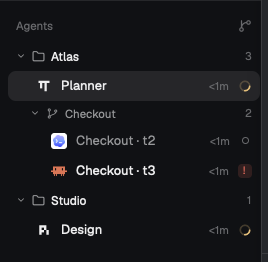

# Herdr Plus

**See what’s running, what changed, and how busy the machine is.**

A community layout for [Herdr Desktop](https://herdr.dev/). It keeps the default layout familiar and adds workspace, agent, and status bar features.


| | What you get |
|---|---|
| **Foldable worktrees** | Fold a project without stopping its agents. The parent row shows whether anything changed and the most urgent agent status across the group. Branch and `↑/↓` still describe the parent checkout. |
| **Branch-based worktrees** | Right-click a Git Space: **New branch and worktree…** creates a branch from a local or fetched remote base; **Checkout existing branch…** creates only a worktree for a local branch. |
| **Status at a glance** | An amber square marks uncommitted changes. A ring spins while an agent is working, `!` means blocked, and a dot marks done. Priority: blocked → working → done. |
| **Agents by project** | Open the **Agents** sort menu → **Grouped by project**. Projects and worktrees fold independently, and each agent gets its own row—even when several share a tab. |
| **Live line counts** | Green `+` and red `−` show tracked text changes against `HEAD` under the focused terminal’s current directory, including staged and unstaged edits. |
| **Machine usage** | The status bar follows the active workspace’s machine (macOS or Linux). It shows one-second CPU snapshots every three seconds while the window is active, plus the latest memory usage. Hover for CPU load, memory totals, home disk space, and uptime. |
| **macOS Dock badge** | Counts blocked or finished agents you haven't viewed. Focus each agent’s terminal to clear its alert without clearing the others. |

## Feature close-ups



*Grouped by project: expand Atlas and its Checkout worktree to see each agent and its status.*


*Folded Spaces: a project row summarizes uncommitted changes and agent attention across its worktrees.*


*Status bar: machine usage on the left, Git line counts on the right.*

## Install

Requires Git and Herdr Desktop (tested with **0.1.16**). Launch Herdr once before installing.

### Ask your agent

Copy this prompt into your coding agent:

```text
Read ~/.config/herdr-app/AGENTS.md, then install and activate the Herdr Plus layout from https://github.com/gsgtzq/herdr-plus without overwriting my existing customizations.
```

### Install manually

```sh
git clone https://github.com/gsgtzq/herdr-plus.git
cd herdr-plus
app_home="${HERDR_APP_HOME:-$HOME/.config/herdr-app}"
cp -R layouts mods "$app_home/"
herdr-app do layout.switch --name herdr-plus
```

Back up any files you already have with these same names before copying. To switch back: `herdr-app do layout.switch --name main`.

[Build recipe](RECIPE.md) · [Apache 2.0](LICENSE) · [Upstream attribution](NOTICE)
