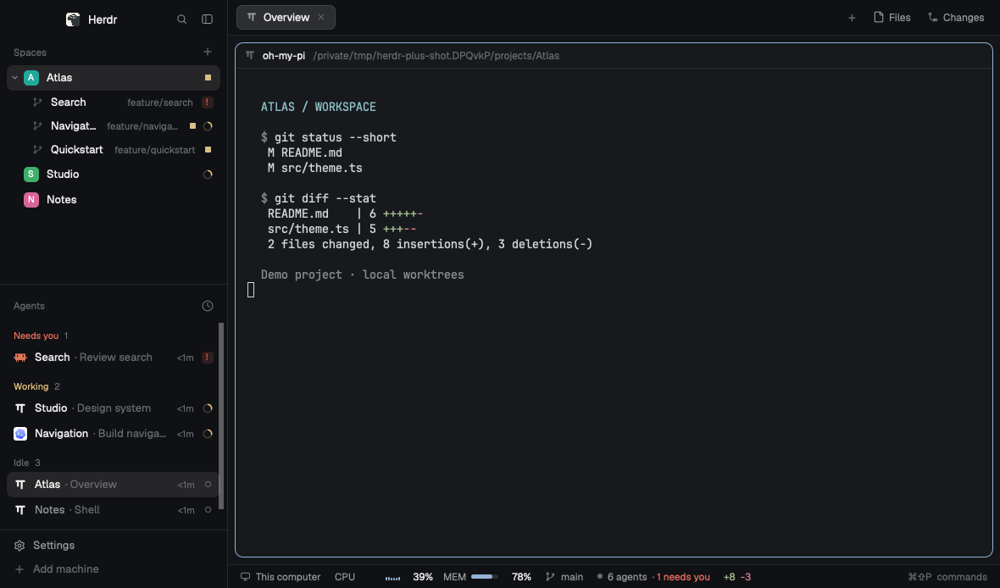

# Herdr Plus

The stock Herdr workspace with foldable worktrees, change and agent badges in Spaces, and Git line counts in the bottom bar.

## What you see

The 268 px sidebar has the normal Herdr chrome, Spaces above Agents, and the normal footer. Top-level avatars align in one column; a chevron sits to their left only for projects with nested worktrees. Nested rows are 28 px high with an indented branch icon; parent rows are 30 px. Git details and badges sit at the right edge. On the right, the normal tabs, terminal panes, Files and Changes panels sit above a 28 px status bar. Added and deleted line counts use the theme’s green and red, just after the agent count. Both mods follow the active Herdr theme.
The machine name is followed by a compact CPU bar history and memory progress bar, each with its current percentage.

## How it behaves

- The chevron hides or reveals only its worktree rows and remembers the choice. Selecting a row, reordering by dragging, and opening the context menu still work. If a hidden worktree is active, the parent row is highlighted.
- Expanded rows report only their own state. A folded parent shows a single amber square if any checkout in the group has uncommitted changes, and its highest-priority agent state across all tabs and panes: blocked (`!`), working (animated ring), then done (solid dot). Idle has no badge. The parent’s Git branch and ahead/behind counts never include children.
- The status bar follows the focused terminal, including the directory scope. It hides counts when no tracked text lines have changed, or when there is no Git checkout.
- Usage follows the machine named in the status bar. The CPU history keeps 16 one-second snapshots, sampled every three seconds while the window is active. Memory shows the latest sample. Hover over either meter for logical core count, load averages, memory totals, home filesystem space and uptime.

## Built from

- `layouts/herdr-plus.json` clones the shipped `main` tree, replacing the `spaces` and `status` blocks. It uses the shipped `workspace-chrome`, `agents`, `tabs`, `pane`, `files`, and `changes` mods; its settings thumbnail is `layouts/herdr-plus.svg`.
- `mods/spaces-agent-status` groups spaces by machine and Git common directory, uses `agents()` for live status, and stores fold state locally. It reuses the shipped branch, chevron, and spinner assets. Git metadata comes from read-only `exec("git", …)` calls where each checkout lives; `watchFolder()` refreshes local data. The inherited sidebar uses `hc` to list and manage machines.
- `mods/workspace-git-status` uses `focused()` to run a read-only, directory-scoped `git diff --numstat` on the terminal’s machine. It updates on focus or directory change and polls every five seconds while the window is active. Neither mod adds external network calls.
- `host-usage.js` runs one read-only shell probe through `exec` on the displayed machine per sample. It uses `iostat` and `vm_stat` on macOS, `/proc` on Linux, and `df` for home filesystem space. No installer, background daemon, or external service is needed.

## Watch out

- A worktree is foldable only when its main checkout also has a Space. Worktrees on different machines never group together.
- The amber square includes untracked files; line counts exclude untracked files, binary changes, and changes outside the terminal’s directory. The status bar compares the working tree with `HEAD` (or an empty tree before the first commit), not two diff totals added together.
- Uses the desktop app’s JavaScript mod API, not the Herdr TUI. Both mods depend on the shipped `workspace-chrome` assets; don’t copy the full app defaults into the package.
- Usage is shown only for macOS and Linux machines that return a complete CPU and memory sample. Switching machines clears the graph rather than mixing hosts.

## Done when

1. Fold a parent with a dirty worktree and a working agent elsewhere in the group. Only the parent remains visible, with the square and spinner. A blocked agent takes precedence. Expanding restores each row’s own badges.
2. Change tracked text in two sibling directories. Focus a terminal in one directory and verify the bar counts only its changes. Switch or revert the edits and verify the count updates.
3. `herdr-app check` passes for both mods, and `layout.switch` can switch between `main` and `herdr-plus`.
4. On macOS or Linux, the bar shows CPU and memory percentages beside the machine name. Hover for the host details; change machines and verify old samples do not carry over.
